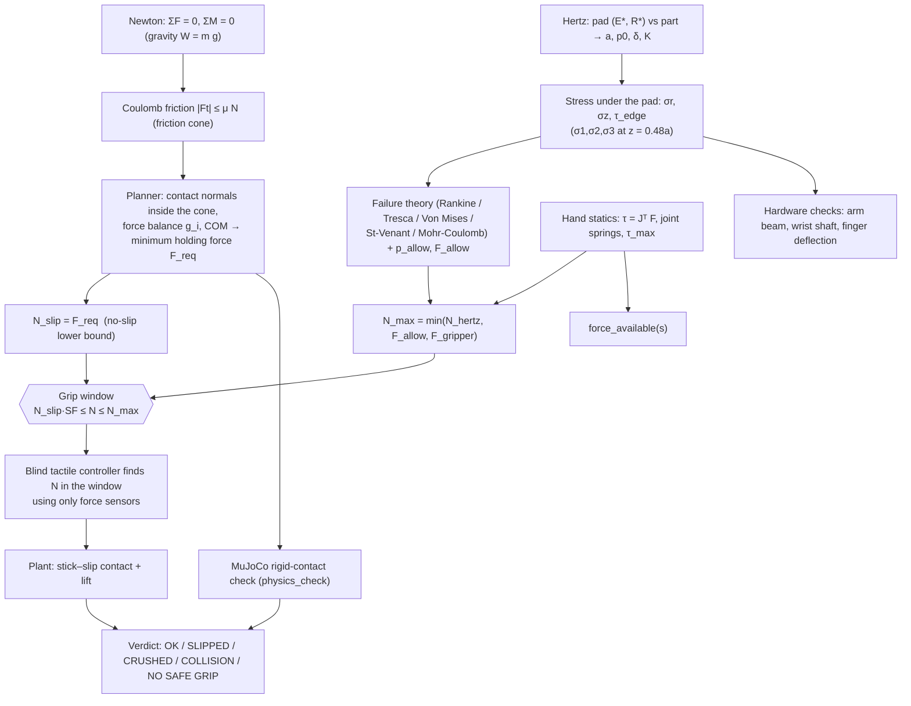

# grip_gz — the physics, from first principles

> A guided tour of **every physical idea** inside `mujoco_15.sh` (the generator of the ROS 2 package `grip_gz`):
> a geometry-true multi-finger hand that plans, executes and verifies a grasp in MuJoCo while a
> Mechanics-of-Solids (MoS) layer checks that the part is neither dropped nor crushed.
>
> Companion file: [`README_RUN.md`](README_RUN.md) — how to install and run it on Ubuntu.

Every formula below is tagged with the **module and function** that implements it, so you can open the code and
check the equation line by line. Numbers quoted in worked examples were recomputed from the same formulas.

---

## Table of contents

0. [What is real physics and what is a model](#0-what-is-real-physics-and-what-is-a-model)
1. [The whole chain in one picture](#1-the-whole-chain-in-one-picture)
2. [Statics and friction — "will it slip?"](#2-statics-and-friction--will-it-slip)
3. [Contact mechanics (Hertz) — "what does the pad do to the part?"](#3-contact-mechanics-hertz--what-does-the-pad-do-to-the-part)
4. [Failure theories — "will it break?"](#4-failure-theories--will-it-break)
5. [Stress and strain toolbox](#5-stress-and-strain-toolbox)
6. [Structures: beams, shafts, shells, energy methods](#6-structures-beams-shafts-shells-energy-methods)
7. [Robotics layer: kinematics, statics, planner](#7-robotics-layer-kinematics-statics-planner)
8. [Control layer: the blind tactile controller](#8-control-layer-the-blind-tactile-controller)
9. [Plant: stick–slip dynamics](#9-plant-stickslip-dynamics)
10. [MuJoCo layer](#10-mujoco-layer)
11. [CAD → physics pipeline](#11-cad--physics-pipeline)
12. [Parameter dictionary](#12-parameter-dictionary-every-constant-and-why-it-has-that-value)
13. [GUI number → formula → module index](#13-gui-number--formula--module-index)
14. [Assumptions and limitations](#14-assumptions-and-limitations-read-this)
15. [Sources](#15-sources)

---

## 0. What is real physics and what is a model

The package has **three layers**, and it matters which one produces which number:

| Layer | Modules | What it is |
|---|---|---|
| **A. Analytic model** (drives the dashboard) | `materials`, `mos`, `hand`, `controller_core`, `hand_plant`, `nptel_priority` | Closed-form mechanics + a small custom stick–slip simulator. All forces, stresses, safety factors and the lift result you see in the GUI come from here. |
| **B. MuJoCo viewer** (visual only) | `world`, `gripper_models`, `dashboard` | Draws the arm, hand and part with MuJoCo. Geometries use `contype=0 conaffinity=0` and the part is a **mocap** body: it is *placed* where layer A says it is, not pushed by MuJoCo contacts. |
| **C. MuJoCo rigid-body verification** | `physics_check` | Rebuilds the same hand as real colliding bodies, applies joint torques `Jᵀf`, descends, closes, lifts, and counts contacts. A plan is accepted only if it really lifts the part with **zero palm/phalanx contact**. |

So the honest summary is: *the dashboard is an analytic simulation; MuJoCo's contact solver is used as an independent check of the plan, not as the source of the dashboard numbers.*

---

## 1. The whole chain in one picture



**The core idea:** a grasp is safe if the normal force `N` lies in a window.

* **Floor** — `N_slip`: below it friction cannot carry the weight (Section 2).
* **Ceiling** — `N_max`: above it the pad stress breaks/yields the part, or the gripper/shell limit is hit (Sections 3–4).

Everything else (planner, controller, plant, CAD) exists to *find, track and verify* a force inside that window.

### Symbol glossary

| Symbol | Meaning | Code |
|---|---|---|
| `m, W = m g` | part mass, weight (`g = 9.81 m/s²`) | `G`, `o['m']` |
| `μ` | friction coefficient pad/part | `o['mu']` |
| `N` | normal force **per fingertip** | `N`, `fz` |
| `n` | number of fingers in contact | `n_f`, `n_act` |
| `E, ν` | Young's modulus, Poisson ratio | `o['E']`, `o['nu']` |
| `E*` | Hertz contact modulus | `e_star()` |
| `R*` | effective radius of curvature | `r_eff()` → `Re` |
| `a, p0, δ` | contact radius, peak pressure, approach | `hertz_a/p0/delta` |
| `K` | contact stiffness, `F = K δ^{3/2}` | `K` |
| `σ1≥σ2≥σ3` | principal stresses | `ms['sig1..3']`, `p` |
| `p_allow, F_allow` | allowed peak pressure / allowed force | `o['p_allow']`, `o['F_allow']` |
| `s` | finger curl (0 = open, ~1 = closed) | `s_contact`, `joint_angles()` |
| `J` | finger Jacobian | `jacobian()` |

---

## 2. Statics and friction — "will it slip?"

### 2.1 Equilibrium (Newton)

A held part is a rigid body at rest: `ΣF = 0`, `ΣM = 0`. Vertically the fingertips must supply a friction force equal to the weight:

```math
\sum_i v_i = W = m g .
```

### 2.2 Coulomb friction and the friction cone

At each contact the tangential force obeys

```math
|F_t| \le \mu N \qquad\Longleftrightarrow\qquad \text{force lies inside a cone of half-angle } \alpha=\arctan\mu .
```

### 2.3 The simplest no-slip bound

With `n` identical pads each carrying `μN` vertically: `n μ N ≥ m g`, hence

```math
N_{slip}= \frac{m g}{n\,\mu} \qquad (\text{materials.truth}).
```

With a planned grasp the factor `n` is replaced by the planner's real contact layout:
`N_slip = m g /(μ · fric_gain)`, where `fric_gain = W/(μ F_req)` (`plan_from_alt`, `GRASP_FG`). In other words **`N_slip` is exactly the planner's minimum holding force `F_req` per reference finger.**

Naive 5-finger estimates for the built-in specimens (before the planner refines them):

| Specimen | m [kg] | μ | N_slip = m g /(5 μ) |
|---|---|---|---|
| Steel block | 1.00 | 0.60 | 3.27 N |
| Apple | 0.20 | 0.70 | 0.56 N |
| Egg | 0.06 | 0.40 | 0.29 N |
| Glass tumbler | 0.25 | 0.60 | 0.82 N |
| Foam block | 0.02 | 0.80 | 0.049 N |
| Plastic bottle (full) | 0.53 | 0.50 | 2.08 N |

### 2.4 Contacts whose normal is *not* horizontal

Real parts have curved or tilted walls. A fingertip pushes horizontally (direction `−u`), but the surface normal `n` is tilted. The friction cone must still contain the resultant.

* **Necessary test** (vectorised pre-filter in `_search1`): the angle between normal and push direction must stay inside the cone,
  ```math
  \cos\theta \ge \cos(\arctan\mu)=\frac{1}{\sqrt{1+\mu^2}} .
  ```
* **Exact per-contact capacity** (`hand.friction_vmax`): given the horizontal push `p = −u` and normal `m = −n_out`, find the largest extra *vertical* friction force `v` such that the total tangential force stays on the cone. With `N0 = p·m`, `N1 = e_z·m`, `a = p − N0 m`, `b = e_z − N1 m` the condition `|a + v b|² ≤ μ²(N0 + v N1)²` is the quadratic `A v² + B v + C ≤ 0`:
  `A = b·b − μ²N1²`, `B = 2(a·b − μ²N0N1)`, `C = a·a − μ²N0²`. The code returns the larger root; a negative value means "the horizontal push alone is already outside the cone" → the grasp is rejected (`'contact normal outside friction cone'`).

### 2.5 Horizontal force and torque balance (no net push on the part)

Fingers on opposite sides push horizontally with forces `g_i F u_i` (weights `g_i`). For the part not to be shoved or spun, the planar force/torque rows must vanish:

```math
\sum_i g_i\,u_{i,x}=0,\qquad \sum_i g_i\,u_{i,y}=0,\qquad \sum_i g_i\,(x_i u_{i,y}-y_i u_{i,x})=0 .
```

`hand.balance_gains` solves `A g = 0` with `g_i ≥ G_MIN = 0.15` and `g` as uniform as possible (iterative pseudo-inverse with active-set clamping). If no non-negative solution exists the candidate is discarded (`'no force balance'`).

### 2.6 Vertical load sharing and the centre of mass

Contact `i` can supply a vertical friction force `0 ≤ v_i ≤ κ_i g_i F` (`κ_i` from §2.4). The weight acts at the centre of mass (COM), so both force **and moment** must balance:

```math
\sum v_i = W,\qquad \sum v_i\,x_i = W\,x_{com},\qquad \sum v_i\,y_i = W\,y_{com}.
```

The set of achievable `(ΣF, ΣMx, ΣMy)` triples for `0 ≤ v_i ≤ κ_i g_i F` is a **zonotope** (a Minkowski sum of line segments). `hand.required_force` tests membership exactly using its support function over every face normal `d = aᵢ × aⱼ`, and returns the smallest `F` for which the weight vector lies inside:

```math
F_{req}=\max_d \frac{d\cdot b}{\sum_i \kappa_i g_i \max(0,\,a_i\cdot d)} .
```

Degenerate cases are handled explicitly: with only two (or collinear) contacts the zonotope is flat; the COM must lie on the pinch line or the part pivots like a pendulum, so the code multiplies `F_req` by a penalty `1 + 60·max(off − 2 mm, 0)` where `off` is the COM distance from that line.

### 2.7 Torque from an off-centre weight

An off-centre COM (offset `e`) loads the wrist with a torque `T = m g e` (`mech_extras.ASSUME['com_offset']=15 mm`), used in the shaft analysis (§6.3).

### 2.8 Margins used downstream

| Constant | Value | Role |
|---|---|---|
| `Params.margin` | 15 % | After two static probes the controller raises force by 15 % |
| `SLIP_SF` | 1.25 | Decision page: required force = `1.25·N_slip` |
| `F_scale` (physics check) | 2.0, then 3.0, 4.0 | MuJoCo test applies `F_scale·F_req`, capped at `0.8·min(F_allow, F_max)` |
| `f_lim` in planner | `0.8·min(F_allow, F_max)` | Plans needing more are reported **NO SAFE GRIP** |

---

## 3. Contact mechanics (Hertz) — "what does the pad do to the part?"

A soft elastomer fingertip pressed onto a stiff or soft part creates a **small elastic contact patch**. Hertz (1882) solves this for two smooth elastic bodies.

### 3.1 Assumptions (of the model, not of the world)

Linear elasticity, small strains, smooth non-conforming surfaces, contact radius `a ≪` body radii (half-space), frictionless normal problem (friction added as a correction, §3.4).

### 3.2 Formulas implemented in `materials.py`

Contact modulus and effective radius:

```math
\frac1{E^{\ast}}=\frac{1-\nu_1^2}{E_1}+\frac{1-\nu_2^2}{E_2},\qquad \frac1{R^{\ast}}=\frac1{R_1}+\frac1{R_2}.
```

For a flat part `R_obj = ∞`, so `R* = R_pad` (`r_eff`). Then

```math
a=\Bigl(\frac{3FR^{\ast}}{4E^{\ast}}\Bigr)^{1/3},\qquad p_0=\frac{3F}{2\pi a^2},\qquad \delta=\frac{a^2}{R^{\ast}},\qquad F=K\delta^{3/2},\ \ K=\tfrac43E^{\ast}\sqrt{R^{\ast}}.
```

Inverting `p0(F)` gives the force at which the peak pressure reaches an allowed value (`force_for_p0`):

```math
F=\frac{\pi^3 R^{\ast 2}\,p_0^3}{6\,E^{\ast 2}} .
```

*(Derivation: substitute `a²=(3FR*/4E*)^{2/3}` into `p0 = 3F/2πa²`, cube both sides and solve for `F`.)*

**Why this matters physically.** `F ∝ δ^{3/2}` means the contact stiffens as it is pressed. The controller exploits this: it *measures* `K = F/δ^{3/2}` during a squeeze and from it infers the part's stiffness (§8).

### 3.3 The pad

| Pad | R | E | ν | Meaning |
|---|---|---|---|---|
| `small` | 25 mm | 2 MPa | 0.49 | soft rubber/silicone; `ν→0.5` = nearly incompressible |
| `large` | 100 mm | 2 MPa | 0.49 | flatter pad → larger `a`, lower `p0` for the same force |

### 3.4 Sub-surface stress under the pad (`mos.py`)

Hertz stresses peak **below** the surface. Along the axis, with `ζ = z/a`:

```math
\sigma_z=-\frac{p_0}{1+\zeta^2},\qquad \sigma_r=\sigma_\theta=-p_0\Bigl[(1+\nu)\bigl(1-\zeta\arctan\tfrac1\zeta\bigr)-\frac{1}{2(1+\zeta^2)}\Bigr].
```

The code evaluates them at **`ζ = 0.48`** (`ZETA`): for `ν≈0.3` the maximum shear stress `τ = |σr − σz|/2 ≈ 0.31 p0` sits at `z ≈ 0.48a` (Johnson, *Contact Mechanics*, §3.3). Worked example — apple, `N = 1.5·N_slip = 0.84 N`:
`a = 1.74 mm`, `p0 = 133 kPa`, `δ = 0.20 mm`, representative strain `0.2a/R* = 2.3 %`, `σz/p0 = −0.81`, `σr/p0 = −0.22`, `τ_axis/p0 = 0.30`.

### 3.5 Friction inside the patch (Mindlin / Cattaneo)

When a tangential force `Q` is applied, the contact does not slip all at once: an inner **stick zone** of radius `c` survives while the outer annulus slips:

```math
\frac{c}{a}=\Bigl(1-\frac{Q}{\mu N}\Bigr)^{1/3}\qquad(q=\min(1,|f_y|/\mu N)).
```

`c/a = 1` ⇒ full stick; `c/a → 0` ⇒ gross sliding. The dashboard shows it as the *Mindlin stick zone* gauge. The mobilised friction coefficient is `μ_mob = min(μ, |f_y|/N)` and the shear traction at the patch edge is `τ_edge = μ_mob p0`.

### 3.6 Equivalent stresses computed (`mos_state`)

With `τ_axis = |σr−σz|/2` and `τ_edge`:

```math
\sigma_{Tresca}=2\sqrt{\tau_{axis}^2+\tau_{edge}^2},\qquad
\sigma_{VM}=\sqrt{(\sigma_r-\sigma_z)^2+3\tau_{edge}^2},
```

```math
\sigma_{Rankine}=\frac{1-2\nu}{3}\,p_0+\frac{(4+\nu)\pi}{8}\,\mu_{mob}\,p_0 .
```

The last line is the peak **tensile** stress at the trailing edge of a sliding contact (Johnson; Hamilton) — the one that cracks brittle parts such as glass.

### 3.7 Allowables and the 0.62 / 1.6 factors

* `p_allow` is the **peak contact pressure** the material tolerates. For a ductile part first yield under Hertz contact occurs at `p0 ≈ 1.6·Y` (code: `plasticity()`, `p_y = 1.60·Y`). Equivalently the peak Von Mises/Tresca stress under the pad is `≈ 0.62 p0`, so `σ_y_allow = 0.62·p_allow` (`mos_state`).
* For CAD parts (`cad.py`) `p_allow` is derived from material strength and a safety factor `SF`:
  * ductile / cellular: `p_allow = strength / (0.62·SF)`
  * brittle: `p_allow = strength / (max((1−2ν)/3, 0.05)·SF)` (the Rankine edge-tension factor of §3.6)
  * shell: no pressure limit, a force limit `F_allow` (default 10 N) instead.
* **Force ceiling:** `N_hertz = force_for_p0(p_allow)`, and
  ```math
  N_{max}=\min(N_{hertz},\,F_{allow},\,F_{max}=40\,\text{N}).
  ```

### 3.8 Grip windows for the built-in specimens (`python -m grip_gz.materials`)

Small pad, 5 fingers, naive `N_slip`:

| Specimen | E* [MPa] | R* [mm] | N_slip | N_hertz | N_max | ratio N_max/N_slip |
|---|---|---|---|---|---|---|
| Steel block | 2.63 | 25.0 | 3.27 N | ~7×10⁹ N | 40 N (gripper) | 12.2 |
| Apple | 1.80 | 14.9 | 0.56 N | 9.58 N | 9.58 N | 17.1 |
| Egg | 2.63 | 11.7 | 0.29 N | ∞ | 20 N (shell) | 68 |
| Glass tumbler | 2.63 | 14.6 | 0.82 N | ∞ | 25 N (brittle) | 31 |
| Foam block | 0.054 | 25.0 | 0.049 N | 8.9 N | 8.9 N | 182 |
| Bottle (full) | 2.63 | 13.6 | 2.08 N | ∞ | 12 N (buckling) | 5.8 |

The code labels a window **OPEN** when `N_max/N_slip > 1.3`, otherwise **TOO NARROW**.

### 3.9 Cross-checks included in `mech_extras.py`

* `hertz_check` superposes Boussinesq point-load solutions over `p(r)=p0√(1−r²/a²)` and compares with the closed-form axis stress and centre displacement `u_z=(1−ν²)πp0a/(2E)`.
* `plane_strain` is the 2-D line-contact (Flamant) analogue: half-width `b=√(4P'R*/(πE*))`, `p0=2P'/(πb)`, `σz=−p0/√(1+ζ²)`.
* `ellipse_contact` handles two curved bodies with unequal curvatures using curve fits for the ellipticity `k = 1.0339·α^0.636` and the elliptic integral `E ≈ 1.0003 + 0.5968/α`.

---

## 4. Failure theories — "will it break?"

Peak stress is a tensor; failure needs a **scalar rule**. Five classical theories are implemented in `nptel_priority.utilisation()` (utilisation = equivalent stress / allowed; failure at 1):

| Theory | Statement | Utilisation formula | Best for |
|---|---|---|---|
| **Rankine** (max principal stress) | fails when σ1 reaches tensile strength (or σ3 compressive) | `max(σ1/σt, −σ3/σc, 0)` | brittle: glass, ceramic |
| **Tresca** (max shear stress) | yields when `τmax = (σ1−σ3)/2` reaches `σy/2` | `max\|σi−σj\| / σy` | ductile (conservative) |
| **Von Mises** (distortion energy) | yields when distortion energy reaches the uniaxial value | `√½[(σ1−σ2)²+(σ2−σ3)²+(σ3−σ1)²] / σy` | ductile (accurate) |
| **St-Venant** (max principal strain) | fails when the largest strain reaches the uniaxial one | `max(ε1/σt, −ε3/σc, 0)` with `ε1=σ1−ν(σ2+σ3)` | historical comparison |
| **Mohr–Coulomb** | brittle with `σt ≠ σc` | `max(σ1,0)/σt + max(−σ3,0)/σc` | brittle, asymmetric strength |

`failure_study()` sweeps `N` from 0.01 N to 500 N, finds by **log-bisection** the force at which each theory reaches `1/FoS` (never below `N_slip`, since below that the part isn't held), and `decision()` returns

```math
\text{window}=\bigl[\,1.25\,N_{slip},\ \min(N_{perm},F_{other})\,\bigr],\quad F_{other}=\min(F_{max},F_{allow}).
```

If the window is empty the dashboard says **NO SAFE GRIP** and suggests more friction, a larger pad radius, more fingers or a lighter part.

Brittle parts use `(σt, σc)` from `ASSUME['brittle']` (glass 40/1000 MPa; egg shell 25/80 MPa).

---

## 5. Stress and strain toolbox

All in `nptel_priority.tensor_report` + `mech_extras` (the module is named after the NPTEL *Mechanics of Solids* course topics it mirrors).

### 5.1 The Cauchy stress tensor at the critical point

At `z=0.48a` in axes `(r, θ, z)`:

```math
\boldsymbol\sigma=\begin{bmatrix}\sigma_r&0&\tau_{edge}\\0&\sigma_\theta&0\\\tau_{edge}&0&\sigma_z\end{bmatrix}.
```

* **Symmetry** `σ=σᵀ` is *moment equilibrium of an infinitesimal cube* (checked: `max|S−Sᵀ|`).
* **Cauchy's formula**: traction on a plane with unit normal `n` is `t = σ n`; normal part `σn = t·n`; shear part `τ = |t − σn n|`.
* **Principal stresses** are the eigenvalues of `σ`; their eigenvectors are the principal directions. Max shear `τmax = (σ1−σ3)/2` acts on planes at 45° to the principal axes (`n = (n1 ± n3)/√2`).
* **Mohr's circles**: three circles through `(σ1,σ2,σ3)`; every plane's `(σn, τ)` lies in the shaded region between them. The page also plots 3 500 random planes as a scatter to prove it.
* **Rotation** `σ' = Q σ Qᵀ` (rows of `Q` = shear direction, `n×e1`, `n`). `σ'33 = σn` and `σ'13 = τ` are verified numerically.

### 5.2 Invariants, hydrostatic and deviatoric parts

```math
I_1=\mathrm{tr}\boldsymbol\sigma,\quad I_2=\tfrac12(I_1^2-\mathrm{tr}\boldsymbol\sigma^2),\quad I_3=\det\boldsymbol\sigma
```

These don't change when axes rotate (checked: `dI1, dI2, dI3`). Split `σ = σm I + s` with `σm = I1/3` (volume change) and deviator `s` (shape change). Then

```math
J_2=\tfrac12 s_{ij}s_{ij},\quad \sigma_{VM}=\sqrt{3J_2},\quad \tau_{oct}=\sqrt{2J_2/3},\quad \sigma_{VM}=\tfrac{3}{\sqrt2}\tau_{oct}.
```

The **Lode angle** from `J3=det s` locates the stress state between triaxial and pure-shear.

### 5.3 Hooke's law and the isotropic constants

```math
\boldsymbol\varepsilon=\frac{1+\nu}{E}\boldsymbol\sigma-\frac{\nu}{E}I_1\mathbf I,\qquad G=\frac{E}{2(1+\nu)},\quad K=\frac{E}{3(1-2\nu)},\quad \lambda=\frac{E\nu}{(1+\nu)(1-2\nu)}.
```

Checks the code prints: `e_v = σm/K` (volumetric), `τmax = G γmax` (max shear strain `γmax=ε1−ε3`), `τoct = G γoct`.

### 5.4 Strain energy and why Von Mises is "distortion energy"

```math
U=\tfrac12\sigma_{ij}\varepsilon_{ij}=\underbrace{\tfrac12\sigma_m e_v}_{\text{volume change}}+\underbrace{\frac{J_2}{2G}}_{\text{shape change}}.
```

Yield (ductile) is driven by the second term, which is why `σVM=√(3J2)` is the yield measure. The page verifies `U_vol + U_dist = U` to rounding error.

### 5.5 Equilibrium of a differential element

`equilibrium_element` builds the six face tractions of a small cube in the Hertz field (using `_hertz_cart`, a point-load Boussinesq superposition on a polar grid) and checks

```math
\frac{\partial\sigma_{ij}}{\partial x_j}+\rho b_i=0 .
```

Result: the residual is at finite-difference level; and the **body force** `ρg` is orders of magnitude below the stress gradient `p0/a` (≈ 10⁻⁴ for the apple example above) — the object's own weight is irrelevant *inside* the contact patch; it matters only through the friction force `fy`.

### 5.6 Elasticity cross-checks (library functions)

Displacement → strain → Hooke → stress consistency (`displacement_check`), cylindrical equilibrium (`equilibrium_check`), St-Venant compatibility for the Flamant solution (`compatibility_check`), strain/rotation split `∇u = ε + Ω` (`strain_rotation_split`). They are *proofs that the formulas used above are self-consistent*; most are not displayed in the GUI.

---

## 6. Structures: beams, shafts, shells, energy methods

The grasp transmits force through real hardware. `nptel_priority.py` (the analysis windows) checks the **arm links**, **finger phalanges** and **wrist shaft**; `mech_extras.py` also checks the **specimen** when it is a thin shell. Hardware data that MuJoCo does not know are *assumptions* in `mech_extras.ASSUME` and `nptel_priority.WRIST` — edit them to match your hardware.

### 6.1 Bending: the beam toolbox (pages "BEAMS")

For a cantilever of length `L` with tip load `P` and self-weight `w` per length (`beam_case`):

| Quantity | Formula | Meaning |
|---|---|---|
| Shear force | `V(x) = P + w(L−x)` | `x` from the fixed end |
| Bending moment | `M(x) = P(L−x) + w(L−x)²/2` | maximum at the root |
| Bending stress | `σ = M y / I` | linear across the section, zero on the neutral axis |
| Tube inertia | `I = π(Do⁴−Di⁴)/64` | arm: Do=40 mm, Di=34 mm → `I = 6.0×10⁻⁸ m⁴` |
| Euler–Bernoulli deflection | `δ = P L³/(3EI) + w L⁴/(8EI)` | from `EI w'' = M` |
| Shear deflection (Timoshenko) | `δs = ∫ V /(κ G A) dx` | adds the shear strain the thin-beam theory ignores |
| Shear coefficient | circle `κ = 6(1+ν)/(7+6ν)`; rectangle `κ = 10(1+ν)/(12+11ν)`; tube per Cowper | how unevenly shear stress is spread |
| Peak shear stress | `τmax = f·V/A` with `f = 4/3` (circle), `3/2` (rectangle) | |

**Why two theories?** For slender members (`L/h > 10`) the shear share of deflection is ~1 % so Euler–Bernoulli suffices; for short stubby members (`L/h < 5`) it does not. The page prints the actual shear share.

**Equal-mass section comparison** (`section_comparison`): tube, solid circle, square, 1:2 rectangle, box and I-beam with the *same cross-sectional area* are compared. Moving material away from the neutral axis raises `I` and cuts both stress and deflection at no extra mass — the reason arms are hollow.

**Worked example** (1 kg steel block, arm fully stretched, `L1=L2=0.40 m`, hand 0.6 kg): payload `P=(m+m_hand)g = 15.7 N`, self-weight `w = ρAg = 9.2 N/m`, root moment `≈ 15.5 N·m`, root bending stress `≈ 5 MPa` against 240 MPa yield. The heaviest payload that keeps link 1 at `σy/2` is `≈ 45 kg`, whereas the friction limit `n μ F_max /g = 5·0.6·40/9.81 ≈ 12 kg` comes much earlier — so *the fingers, not the arm, limit the load* (`arm_beams` reports which one governs).

### 6.2 Finger phalanges and three energy methods (page "FINGER DEFLECTION")

One finger is three beams in series loaded by the tip force `N`. The tip deflection is computed **three independent ways** and must agree:

1. **Direct integration** of `EI w'' = M(x)`, `M = N(L−x)`.
2. **Castigliano**: strain energy `U = ∫ M²/(2EI) dx` (+ shear `∫ V²/(2κGA) dx`), deflection `δ = ∂U/∂P`; rotation `θ = ∂U/∂M0` with a dummy moment `M0`. Evaluated analytically *and* by central finite difference.
3. **Unit-load (virtual work)**: `δ = ∫ M m/(EI) dx` where `m(x)` is the moment from a unit load at the tip.

The page prints their maximum relative disagreement (it is at numerical-integration level). Two related theorems are also demonstrated in `mech_extras`: **Maxwell–Betti reciprocity** (`reciprocity`, `energy_extra`: the deflection at A due to a load at B equals the deflection at B due to the same load at A) and a statically indeterminate propped cantilever solved by the unit-load method (`R/P = 5/16`, `M_wall/PL = 3/16`).

**Joints dominate.** The real finger is a rigid-link-plus-spring mechanism: joint torsion springs `k = (30, 20, 12) N·m/rad`. With lever arms `l_k` from joint `k` to the contact point, Castigliano on the springs gives

```math
\delta_{joint}=\frac{\partial}{\partial F}\sum_k\frac{(F\,l_k)^2}{2k_k}=F\sum_k\frac{l_k^2}{k_k}\;=\;F\cdot\text{compliance along normal}.
```

For a 20×22 mm aluminium phalanx block this is about 10³ times the phalanx bending, so phalanx bending is a sub-percent correction (the GUI prints the exact ratio for the selected section). That justifies the model used by the plant: *rigid links + springs*.

### 6.3 Wrist shaft under combined loading (page "WRIST SHAFT")

Hollow steel tube, OD 20 / ID 14 mm, length 80 mm, subject to four loads at once:

* **Axial** `F = (W_o+W_h) sin β` (tilt `β=15°`)
* **Bending** `M = [W_o(L+l_o)+W_h(L+l_h)] cos β` with `l_o=100 mm`, `l_h=40 mm` overhangs
* **Torsion** `T = W_o e` (`e=15 mm` COM offset)
* **Transverse shear** `V=(W_o+W_h)cos β`

Weights use `g_eff = g + a_lift = 9.81 + 2.0 m/s²` (lifting acceleration).

Stresses at angle `φ` around the section:

```math
\sigma=\frac{F}{A}+\frac{M r}{I}\cos\varphi,\qquad \tau=\frac{T r}{J}+\tau_V\sin\varphi,\qquad
\tau_V=\frac{4V(r_o^2+r_o r_i+r_i^2)}{3\pi(r_o^4-r_i^4)}
```

(the last is the exact peak shear of a hollow circular tube). Principal stresses `σ1,2 = σ/2 ± √((σ/2)²+τ²)`, `σ3 = 0`. Then:

```math
\sigma_{VM}=\sqrt{\sigma^2+3\tau^2},\qquad \sigma_{Tresca}=\sqrt{\sigma^2+4\tau^2},\qquad \text{twist } \phi=\frac{TL}{GJ},\qquad \text{tip deflection}=\frac{VL^3}{3EI}+\frac{M_{tip}L^2}{2EI}.
```

Worked example (1 kg part): `M ≈ 2.9 N·m`, `σ ≈ 4.8 MPa`, `τ_T ≈ 0.15 MPa`, `τ_V ≈ 0.22 MPa`, Von Mises ≈ 5 MPa → factor of safety ≈ 50 against 250 MPa. `wrist_m_allow` bisects for the heaviest mass that still meets `FoS ≥ 2`.

`mech_extras.torsion_sections` compares solid circle, hollow tube, Bredt–Batho thin closed tube (`J = 4Am²t/Lm`, `τ = T/(2Amt)`), the **same tube slit open** (`J = ΣLt³/3` — far weaker, and it warps) and a rectangle (St-Venant series for `J`).

### 6.4 The specimen as a thin shell (library: `thin_shell`, `tube_combined`, `buckling`)

Eggs, PET bottles and glass tumblers are **thin-walled** (`t ≪ R`):

* Pressurised: hoop `σθ = pR/t`, longitudinal `σL = pR/(2t)`; thick-wall Lamé `σr = A − B/r²`, `σθ = A + B/r²` (spheres: `A − 2B/r³`, `A + B/r³`) for the sealed / pressurised tube demo (`ASSUME['tube_demo']`).
* **Thin ring under a diametral squeeze** (a finger pair pressing a shell): by Castigliano with `∂U/∂M0 = 0`,
  ```math
  M_{load}=\frac{PR}{\pi}\approx0.318\,PR,\qquad \Delta D=\Bigl(\frac\pi4-\frac2\pi\Bigr)\frac{PR^3}{EI}\approx0.149\,\frac{PR^3}{EI},\qquad \sigma_b=\frac{6M}{t^2}.
  ```
  These are the "0.318" and "0.149" constants in the code (`ring_castigliano` derives them numerically).
* **Buckling**: Euler `Pcr = π²EI/(KL)²` (`K=1` pinned, `0.5` fixed, `2` cantilever; thin tube `I=πR³t`), classical shell `Pcr = 2πEt²/√(3(1−ν²))` with a 0.2 knock-down (real shells are imperfection-sensitive). Beyond Euler: Johnson parabola for short columns and the secant formula for an eccentric load (`column_regimes`).

This is why the built-in thin-shell objects carry a **force limit** `F_allow` rather than a pressure limit: Hertz assumes a half-space, which a 0.3 mm wall is not.

### 6.5 Other textbook helpers in `mech_extras.py`

Available as importable functions (they back the NPTEL-style topic list; most are not drawn in the GUI):

| Topic | Function(s) |
|---|---|
| 2-D stress transformation, Mohr, stress map of the Hertz field | `stress_transform_2d`, `stress_map` |
| Unsymmetric bending, principal axes of an angle section | `unsymmetric_bending`, `angle_section` |
| Shear flow, shear centre of thin open sections, Timoshenko vs Euler | `thin_section_shear_centre`, `shear_centres`, `shear_beam`, `timoshenko_beam` |
| Composite (transformed-section) and curved (Winkler–Bach) bending | `composite_bending`, `winkler_bach` |
| Plasticity: yield vs plastic moment (`Mp/My` shape factor), residual stress | `plasticity` |
| Thermal stress `E α ΔT` (uniaxial) and `E α ΔT/(1−ν)` (biaxial) | `thermal` |
| Fatigue: Peterson `Kt` for a hole, S–N (Basquin), Goodman, Miner | `fatigue` |
| Orthotropic (wood) Hooke's law and rotated moduli | `orthotropic` |
| Failure envelopes (Tresca hexagon, Von Mises ellipse, Rankine square, St-Venant, Mohr–Coulomb) | `envelopes` |

---

## 7. Robotics layer: kinematics, statics, planner

### 7.1 Arm kinematics (`arm_ik.py`)

A planar 2-link arm (`L1=L2=0.40 m`, shoulder at `(−0.55, 0.25)` m) moves the wrist to a point `(wx, wz)`. With `X = wx − xs`, `D = zs − wz` the **law of cosines** gives the elbow angle and then the shoulder angle:

```math
\cos\theta_2=\frac{X^2+D^2-L_1^2-L_2^2}{2L_1L_2},\quad
\theta_1=\mathrm{atan2}(D,X)-\mathrm{atan2}\bigl(L_2\sin\theta_2,\;L_1+L_2\cos\theta_2\bigr),\quad \theta_3=-(\theta_1+\theta_2).
```

`θ3` keeps the palm horizontal. The forward map is `x = xs + L1cosθ1 + L2cos(θ1+θ2)`, `z = zs − L1sinθ1 − L2sin(θ1+θ2)`. The tool-centre point is `0.06 m` below the wrist.

### 7.2 Hand architecture (`hand.py`)

Modelled on **Barrett Hand / Robotiq 3F / Yale OpenHand** practice:

* **Opposed groups**: `⌊n/2⌋` "thumbs" on one side of the palm, the rest on the other (`layout`). `n = 3, 4, 5` (`FINGERS=`).
* **Spread joint** per finger (vertical axis at the base, max ±50°) aims its closing plane; **wrist yaw** rotates the whole hand. All fingers aimed at one point → radial **wrap** (cylinders, spheres). Parallel planes → **pinch** (boxes, plates) — the Robotiq "wide/pinch" idea.
* **Three phalanges** `L = (60, 45, 38) mm`, driven by **one tendon**: a *synergy* `q_k = syn_k · s · q_max` with `syn=(1,1,0.8)`, `q_max=80°`. One scalar `s ∈ [0,1]` (curl) closes the finger — an **under-actuated** finger that self-adapts to the part. In MuJoCo this is enforced with `<equality><joint polycoef=…/>` constraints.
* **Dome fingertip**: sphere of radius `tip_r = 11 mm`. A sphere touches *any* surface orientation at one point, so no edge or corner of the finger can dig into the part (the failure of the older flat pad, called out in the script header).

Planar finger kinematics: with cumulative angle `ψ = Σ q`, each link moves the point by `(−L sin ψ, −L cos ψ)` in the (radial, vertical) plane. The dome centre is `pad_back = 12 mm` behind the tip along the link, and the contact point is the dome surface `pad_off = 11 mm` along the inward normal (`finger_points`, `dome_center`, `contact_point`).

### 7.3 Finger statics: Jacobian transpose (`jacobian`, `joint_torques`, `force_available`)

A force `F` at the contact point produces joint torques `τ = Jᵀ F` (principle of virtual work). For joint `k` the torque is `|F·(lever_k)|`, where the lever is the perpendicular distance from the joint axis to the line of force. Each joint has a torque limit `τmax = (12, 8, 4) N·m`. The largest force the finger can exert at curl `s` is

```math
F_{avail}(s)=\min_k\frac{\tau_{max,k}}{|lever_k|}.
```

The plant clips the commanded force to this value, and the dashboard shows the *MCP peak torque load* gauge (`τ/τmax`).

### 7.4 Contact travel and curl limit

`s_limit` finds the curl at which the dome centre stops moving inward (beyond it the finger is curling *away*). `curl_tables` maps `s ↔ x` (closing travel of the dome centre) and `ψ` (tip tilt), so the plant works in a single scalar `x` per finger.

### 7.5 The grasp planner — a search on the **real geometry**

The part is represented by a **signed distance field** `sdf(P)` (negative inside, `shapes.py`): analytic for box/cylinder/sphere, a 3-D grid with trilinear lookup for CAD meshes (§11). Normals are `∇sdf` by central difference.

Search space (`_cands`): *aim point `Q` per finger group × wrist yaw (every 10°) × finger subset*. Subsets go from all `n` fingers down to 2 (`_subsets`: each must include both groups). For each candidate:

1. **Contact search** (`_find_contacts`): march the dome centre along its curl path and find the first `s` where `sdf ≤ tip_r`, by linear interpolation.
2. **Friction-cone pre-filter** (vectorised, §2.4).
3. **Exact evaluation** (`_evaluate`): `κ_i` from `friction_vmax`, force balance `g` from `balance_gains`, required force `F_req` from the zonotope (§2.6), contact tilt `arccos(n·u)`.
4. **Edge robustness** (`_edge_gap`): sample the part 7 mm to each side of every contact. A flat wall falls away by ~0; a rim, corner or thin wall top falls away by millimetres → the cost is multiplied by `1 + 0.4·max(edge_mm − 0.8, 0)`. A contact far from the COM height is penalised by `1 + Δz/20 mm`.
5. **Cost** = `F_req · (1 + max tilt/90°) · robustness`, plus `10⁻³|yaw|` to prefer small wrist rotations.
6. **Swept clearance** (`_path_clearance`): the *whole* hand (rigid sample points of every phalanx, hubs and palm; domes as spheres) is checked at the final pose, along the closing motion and along the descent. Rejected if a rigid point comes within 0.8 mm of the part, a dome penetrates more than 0.5 mm, anything is within 0.5 mm of the table, or two fingers come within 0.8 mm (capsule–capsule segment distance, `_seg_seg_dist`, radii `cap_r`).
7. Surviving alternatives are ranked; plans needing `F_req > 0.8·min(F_allow, F_max)` are reported **NO SAFE GRIP**.

Results are cached by `plan_key` (shape, mass, μ, fingers, COM).

### 7.6 Motion planning (`hand_plant.Episode`)

* **Minimum-jerk** point-to-point profile `s(τ)=10τ³−15τ⁴+6τ⁵` — zero velocity *and* acceleration at both ends (smooth for the object; Flash & Hogan). Peak speed is `1.875×` the mean, which the code uses to size durations.
* Speed limits (`MOTION`): fingertip close `8 mm/s` in the last 6 mm before contact (gentle search), `25 mm/s` far away; arm transit peak `0.12 m/s`, final descent `0.05 m/s`; wrist yaw `0.9 rad/s`; lift `10 mm/s` with `0.02 m/s²` ramp.
* Stages: `HOME → RAISE → OVER → DESCEND → GRASP → LIFT`. Wrist yaw is applied while hovering, before the descent.

---

## 8. Control layer: the blind tactile controller (`controller_core.py`)

The controller does **not** know the object's mass, friction, stiffness or radius. It only has per-finger **normal (`fz`) and tangential (`fy`) force sensors** (plus fingertip position and a wrist load cell), exactly like a robot with tactile sensing. It must settle inside the window of §1.

**Sensor model** (`HandPlant.sense`): bias offsets, Gaussian noise `σ = 0.015 N·√(2/n)` (averaging over `n` fingers), and a small noisy indentation measurement.

**State machine:** `CALIB → WAIT_ARM → CLOSE → SQUEEZE → SETTLE → LIFT → HOLD → DONE` (or `ABORT`).

1. **CALIB** (1 s, hand free in air): measure the sensor bias and noise. The no-contact floor `f0 = max|signal| + 0.05 N`. Detection gates are 5σ-type thresholds (`gate_z`, `gate_y`).
2. **CLOSE**: close at force `3 f0` until the mean normal reading exceeds `1.5 f0` for 3 ticks → contact; records the contact position `x_contact`.
3. **SQUEEZE** (1 s): ramp the force from `f0` to `3 f0` while recording `K = fz/δ^{3/2}`; take the **median** (robust to noise). This single number encodes `4/3·E*·√R*`.
4. **Estimate material** (`_update_mos_estimates`): since both `E_obj` and the contact radius `R*` are unknown, one `K` gives only one number, so the code branches:
   * **Soft part** (`E*_flat < 0.97 E*_pad`, distinguishable from the pad alone): invert `E*_flat = 3K/(4√R*)` with `R*` from the CAD/vision prior, then `1/E* = 1/E*_pad + (1−ν²)/E_obj` (assumes `ν_obj=0.3`) → `E_obj`.
   * **Stiff part**: `E*` is pad-limited, so `K` instead reveals the radius `R* = (3K/4E*_pad)²`, and `E_obj` can only be bounded from below.
5. **Strain cap** (the link from mechanics to control): Tabor's representative strain `ε = 0.2 a/R*` with `a²=R*δ` gives `ε = 0.2√(δ/R*)`. Limiting `ε ≤ ε_allow = 5 %` gives a maximum indentation `δ_lim = (ε_allow/0.2)² R_pad` and therefore
   ```math
   N_{cap}=K\,\delta_{lim}^{3/2}\quad(\le F_{max}).
   ```
   **The controller discovers its own crushing limit from one squeeze.**
6. **LIFT/HOLD — slip control**. Two kinds of events:
   * **Probe**: every `0.4 s` add a small normal "bump" `Δfz` (≥ 3×noise floor). *Physics:* if the part is **stuck**, the tangential force is fixed by the weight and does not respond to extra normal force (`Δfy≈0`). If the contact is **at its friction limit / slipping**, `fy = μN` so `Δfy/Δfz ≈ μ`. Slip is declared when `Δfy/Δfz > 0.15` and `Δfy` exceeds its noise gate. The ratio is the *measured mobilised friction coefficient* (`alpha_d`).
   * **Ramp**: on slip, raise the force with a slew limit `df/dt ≤ boost·(0.6 N/s + 1.2·fd)` (geometric growth, so heavy parts reach large forces quickly but detection lag cannot overshoot). Each consecutive slip makes the next ramp faster (`boost += 0.6`, capped at 6). The ramp ends after 6 quiet ticks *and* a ≥ 30 % gain.
   * After **two consecutive static probes** the force is raised by the 15 % safety margin and held.
   * If slip occurs *at the cap* twice → **NO SAFE GRIP** (abort and release).
7. **Not-carried detector**: if the hand rises faster than the part follows (relative speed > 4 mm/s after 3 mm of rise) the wrist load cell says the weight is not arriving → raise grip now and pause the lift (`lift_held`).
8. **Friction lower bound**: `μ_lb = max(fy/fz)` from smoothed forces with healthy signal-to-noise (static friction `|fy| ≤ μ fz` ⇒ `fy/fz ≤ μ` always, so the maximum observed ratio is a *lower bound* on `μ`). The weight estimate is `m_est = n_f (fy cosψ + fz sinψ)/g`.
9. **Step size** (`_step_size`): `exp(α) + exp(−p_e)` — grow faster when the mobilised friction is high (close to slip) and the pad is only lightly indented; the per-tick increment is scaled between `0.8·f0` and `2·f0`, then clipped by the slew limit above.

A **fixed-force** controller (`Fixed 25 N`) is kept as a baseline: it holds a heavy part easily but crushes the egg and apple — which is the point of the benchmark.

---

## 9. Plant: stick–slip dynamics (`hand_plant.HandPlant`)

A small, **unconditionally stable** simulator of the finger drives, the contact and the part's vertical motion.

**Fingers.** Each finger is a mass–damper (`m_f=50 g`, `b=8 N·s/m`) with the drive force `F·g_i`. Closing speed is limited as in §7.6. On first reaching the planned contact travel `x_c` the finger takes a normal force `N = min(F g_i, F_avail)`, and the pad indents by the Hertz approach plus the finger compliance:

```math
x_f=x_c+\delta_{Hertz}(N)+C(s)\,N,\qquad \delta_{Hertz}=\frac{a^2}{R^{\ast}},\quad C=\sum_k \frac{lever_k^2}{k_k}.
```

First-order contact settling with `τ = 2.5 ms`.

**Part.** The part is a mass on a **tangential spring–damper** at the pads: stiffness `k_t = 4000 N/m` per contact, damping `c_t = 2ζ√(k_t m)` with `ζ = 0.7` (close to the optimum for fast settling). The state is the elastic tangential displacement `w`, the part's height `z_o` and velocity `v_o`. Newton's law per step (implicit Euler, which is why large stiffness cannot blow up):

```math
m\,\dot v_o=F_t-mg,\qquad F_t=-k_t w-c_t(v_o-v_g),\qquad \dot w=v_o-v_g,
```

with `v_g` the gripper (hand) velocity.

**Stick vs slip (Coulomb).** The friction capacity is

```math
F_{cap}=\mu\,\bigl(K_R\text{ if sliding else }1\bigr)\,N_{cap},\qquad K_R=0.85,
```

where `N_cap = fric_gain·ΣN/Σg` for a full grasp (the planned layout) or `½ΣN cos θ_i` while only some fingers touch. `K_R = 0.85` is the **static-to-kinetic** friction drop, giving realistic stick–slip hysteresis. If `|F_t| ≤ F_cap` the pads **stick** and the elastic strain carries on; otherwise `F_t = ±F_cap` (**slip**), `w = −F_t/k_t`, and the part accelerates. The part rests on the table when `z_o ≤ 0`. The tangential elastic strain `w` is also what the tangential sensors read, which is how the controller sees "slip" (§8).

**Safety bookkeeping every tick:** `mos_state(N_peak, f_mean)` for the most loaded pad → stress, `FoS = min(p_allow/p0, F_allow/N)`; `FoS<1` ⇒ **CRUSHED** (the display swaps the part for a deformed red copy). `_check_clearance` evaluates the 3-D hand-vs-part signed distance a few times per simulated second; a dome sinking more than 1.5 mm beyond its allowed soft sink (`δ_Hertz + joint compliance + 1.2 mm`), a rigid point 0.6 mm inside the part or the table, or two fingers overlapping by 1 mm ⇒ **COLLISION**. `_track_contacts` re-solves the contact point on the curved surface (secant polish of `sdf(dome(s)) = tip_r`) as pads roll up the part during lift.

**Verdicts:** `OK` (lifted ≥ 50 %), `SLIPPED OFF` (≥ 20 % then lost), `NOT LIFTED`, `CRUSHED`, `COLLISION`, `NO SAFE GRIP`, `NO OBJECT FOUND`.

---

## 10. MuJoCo layer

### 10.1 Visual scene (`world.py`, `gripper_models.py`, `dashboard.MuJoCoSimBridgeNode`)

* `gripper_models` procedurally generates STL meshes (boxes, cylinders, ellipsoids for the domes, bolt heads) for the base, two arm links, palm and three phalanx types, in several materials/colours.
* `world.build_mjcf` assembles the kinematic tree **shoulder → elbow → wrist → yaw → palm → (spread → MCP → PIP → DIP) × n** with hinge joints, a wooden bench, lights, textured floor and sky.
* Every visual geom has `contype=0 conaffinity=0`; each specimen exists as a **mocap body** (plus a deformed red "crushed" twin). The dashboard sets joint angles from the analytic state each frame and `viewer.sync()`s. Red dots and arrows on the part show each loaded fingertip's contact and force direction.

### 10.2 The independent contact test (`physics_check.py`)

For a planned grasp, `build_model` writes a *new* MJCF with the **same hand** as real colliding bodies:

| Item | Setting | Why |
|---|---|---|
| Time step | 1 ms | stiff contacts |
| `cone="elliptic"`, `impratio=10` | elliptic friction cone, friction constraints 10× stiffer than normal | MuJoCo's convex friction model; high `impratio` limits creep so a sticking contact really sticks |
| Part contacts | `condim=4`, friction `(μ, 0.003, 0.0001)` | sliding **plus torsional** friction (soft-finger contact), tiny rolling friction |
| Fingertips | spheres `r = 11 mm`, `solref = 0.004 1` | the same dome as the analytic model |
| Phalanges/palm | capsules/box, `contype=2 conaffinity=0` | they still collide with the part and table, so unwanted contact is detected |
| Tendon synergy | `<equality><joint polycoef="0 c 0 0 0">` with `c = syn_k/syn_1` | `q2, q3` slaved to `q1` like the real finger |
| Hand height | slide joint `hz` + position actuator `kp=3×10⁴`, `gravcomp` on all hand bodies | a stiff, weightless carrier |
| Part | free joint, true mass, COM from the CAD, inertia `4×10⁻⁴·m` per axis | approximate rotational inertia |

**Test sequence:** descend `1.0 s` (min-jerk) → close `0.8 s` (position servo to just short of contact) → ramp force `1.2 s` → lift 100 mm in `1.5 s` → hold `1.0 s`.

* During force mode each finger's joint torque is `τ = lever · F_hold · ramp · g_i` with `lever = |d x_contact/d q1|` (the same `Jᵀf` idea as §7.3), distributed over the three coupled joints.
* `F_hold = F_scale · F_req`, capped at `0.8·min(F_allow, F_max)`.
* Contacts are scanned every 5 steps. Any contact between the part and a **non-dome** hand geom counts as *rigid contact*; the deepest dome penetration and the number of hand–table contacts are also recorded.
* **Pass** ⇔ `rise > 0.9·100 mm` **and** `slip < 4 mm` **and** zero rigid-contact steps → `LIFTED`. Lifted with rigid contact → `RIGID CONTACT`; otherwise `SLIPPED`.

`verified_plan` tries up to four planner alternatives, each with `F_scale` ×2, ×3, ×4 (skipping any whose 1.3× margin would exceed the force limit) and keeps the first that is `LIFTED`. If none passes it reports **NO SAFE GRIP** and, if a hand with fewer fingers does lift the part, hints `FINGERS=3` (small parts leave no room for five 22 mm fingertips).

### 10.3 The CAD part inside MuJoCo

MuJoCo collides **convex** shapes. A general part is turned into a stack of up to 8 **height bands** (`_bands`): consecutive slices whose outline area and bounding box differ by less than a tolerance are merged, so a hull, funnel or mast is *not* approximated by one mid-height extrusion. Each band's outline is simplified (Douglas–Peucker, 0.25 mm) and decomposed into convex pieces (**ear clipping** triangulation, then **Hertel–Mehlhorn** merging of triangles while the union stays convex), extruded between the band's heights as a convex `<mesh>`. If decomposition loses > 3 % of the area it falls back to the convex hull.

---

## 11. CAD → physics pipeline (`meshprep.py`, `cad.py`, `shapes.py`)

Real downloaded meshes are messy; the pipeline turns them into a clean solid with mass, COM, contact radius and an SDF.

1. **Read** binary/ASCII STL and OBJ natively (PLY/OFF/3MF/GLB via `trimesh`). Binary STL header-count mistakes and ASCII-named binary files are handled.
2. **Clean** (`clean_mesh`): drop NaNs; **weld** vertices (tolerance `2×10⁻⁶·diagonal`: exact quantisation, then a KD-tree pass); drop zero-area and duplicate triangles; remove **debris** (components with `< 0.02 %` of the area *and* `< 2 %` of the diagonal); make winding consistent by flood-filling across shared edges; flip any closed component whose signed volume is negative.
3. **Simplify** to ≤ 120 000 triangles (MuJoCo's per-mesh limit is 200 000): **quadric edge collapse** (Garland–Heckbert, via `fast_simplification`) or vertex clustering with bisection on cell size.
4. **Orient**: detect up-axis (`detect_up`): ships, cars, animals are *mirror-symmetric about a vertical plane*; if a part is symmetric about the plane normal to the file's Z but about neither X nor Y, Z is lateral, so the model is Y-up. Then rotate about Z so the **narrowest width** (`footprint_width`, scan over 0–180° in 2° steps) lies across the finger axis.
5. **Units/scale sanity**: size < 12 mm is assumed a unit mistake and scaled to 40 mm; > 300 mm is scaled to 300 mm; if the width at grasp height exceeds 70 % of the hand opening it is scaled to 55 %. Every change is reported as a `SCALE` warning (`--no-fit` disables it).
6. **Solid cross-sections** (`build_sections`) — independent of watertightness: intersect triangles with `K = min(80, max(10, h/1.5 mm))` horizontal planes, burn the segments into a raster, thicken by 2 px to seal pin-holes, flood-fill the outside, call the rest solid, undo the thickening, trace the outline (sub-pixel `contourpy`).
7. **Volume and COM**:
   * closed mesh — divergence theorem, `V = ⅙ Σ a·(b×c)`, centroid from the signed tetrahedra;
   * open/hollow mesh — `V = Σ A_k Δz`, COM from the weighted section centroids.
   Mass = `ρ V` unless given. If the COM lies in air at the grasp height (chairs, rings), the hand axis is placed at the outline centroid and the off-axis mass is balanced by the planner.
8. **Grasp height**: `z_g = clamp(z_COM, 0.4h, 0.75h)`; the grasp-height section gives the width and the **local contact radii**: a least-squares circle `x²+y²+2ax+2by=c` (→ `r² = c+a²+b²`) fitted to the outline near each y-extreme (horizontal) and to the vertical profile (vertical). If the points are collinear → flat (`R=∞`). The Hertz `R_obj` is the smaller of the two sides (geometric mean of horizontal and vertical when both are curved).
9. **Material → numbers**: table of 16 materials (steel … foam, fruit, thin shell) giving `ρ, μ, E, ν`, strength and failure kind; `p_allow` as in §3.7. Any value can be overridden (`--mu --E --nu --strength --F-allow --R-contact --kind --mass --density`).
10. **Signed-distance volume** (`Shape._build_grid`): per slice, the exact 2-D distance to the outline (KD-tree on the outline sampled at `res/4`, sign by even–odd fill) stacked into a `(levels × ny × nx)` float32 volume (≤ 12 M cells, 60 mm margin for the hand), with **trilinear lookup** for any query. The 3-D distance of an extruded prism is composed as
    ```math
    d=\min(\max(d_{xy},d_z),0)+\bigl\|\max\bigl((d_{xy},d_z),0\bigr)\bigr\|.
    ```
    Beyond the stored field the distance to its edge is added. This one SDF is what the **planner, clearance monitor and physics proxy all share**, so they agree on the geometry.

---

## 12. Parameter dictionary (every constant and why it has that value)

### 12.1 Gripper and pad (`materials.py`)

| Name | Value | Meaning / reasoning |
|---|---|---|
| `F_max` | 40 N | actuator force limit per fingertip |
| `finger_mass`, `finger_damping` | 0.05 kg, 8 N·s/m | drive dynamics (§9) |
| `lift_height` | 0.10 m | target lift; success if ≥ 50 % reached |
| `PADS.small/large` | R 25 / 100 mm, E 2 MPa, ν 0.49 | soft elastomer fingertip (§3.3) |
| `open_half_gap` | `r_open()` = horizontal contact radius with the finger open | defines the largest graspable width |

### 12.2 Hand (`hand.HAND`)

| Name | Value | Meaning |
|---|---|---|
| `L` | 60 / 45 / 38 mm | phalanx lengths |
| `r_base`, `e_pitch` | 85 mm, 36 mm | finger-base distance from palm centre; spacing within a group |
| `syn` | (1, 1, 0.8) | tendon synergy ratios |
| `q_max` | 80° | joint travel at `s=1` |
| `k_joint` | (30, 20, 12) N·m/rad | joint torsion stiffness (§6.2) |
| `tau_max` | (12, 8, 4) N·m | joint torque limits (§7.3) |
| `tip_r`, `pad_off`, `pad_back` | 11, 11, 12 mm | dome radius and its placement |
| `palm_x/y/thick` | 108 / 82 / 20 mm (half-sizes for x,y) | palm box |
| `palm_clear`, `table_clear`, `approach_gap`, `hover_margin` | 12, 4, 3, 30 mm | safety distances (palm above part, fingers above table, stand-off while closing, hover height) |
| `env` | (15.5, 14.5, 14.0, 11.5) mm | link envelope radii for clearance |
| `cap_r` | (13, 12.5, 10.5) mm | capsule radii for finger–finger clearance |
| `spread_max` | 50° | spread-joint range |
| `G_MIN` | 0.15 | smallest allowed force weight `g_i` |

### 12.3 Controller (`Params`)

| Name | Value | Meaning |
|---|---|---|
| `t_cal` | 1.0 s | calibration time |
| `f0_margin`, `f0_min` | 0.05 N | sensor-noise floor margin |
| `close_mult`, `contact_mult` | 3.0, 1.5 | closing force and contact threshold in units of `f0` |
| `t_squeeze`, `squeeze_mult` | 1.0 s, 3.0 | stiffness-identification squeeze |
| `eps_allow` | 0.05 | allowed representative strain (→ `N_cap`, §8) |
| `W` | 10 | slip-detection window (samples at 100 Hz) |
| `r_thr` | 0.15 | `Δfy/Δfz` threshold for "slipping" |
| `T_probe`, `T_bump` | 0.4 s, 0.15 s | probe period and bump duration |
| `bump_mult`, `bump_frac` | 3.0, 0.10 | bump size = max(3·f0, 10 % of force) |
| `margin` | 0.15 | 15 % safety margin on holding force |
| `rate_abs`, `rate_rel` | 0.6 N/s, 1.2 /s | ramp slew limit |
| `ramp_min_gain` | 0.30 | a ramp must raise force ≥ 30 % |
| `boost_step`, `boost_max` | 0.6, 6.0 | faster ramp after each consecutive slip |
| `t_hold`, `t_lift_timeout` | 1.2 s, 150 s | hold time; give-up time |

### 12.4 Built-in specimens (`materials.OBJECTS`)

| Key | Shape | m [kg] | μ | E | ν | p_allow | F_allow | Failure mode |
|---|---|---|---|---|---|---|---|---|
| `steel` | box 50 mm | 1.00 | 0.60 | 200 GPa | 0.30 | 250 MPa | – | Von Mises |
| `steel_2kg` | box 50×50×102 | 2.00 | 0.60 | 200 GPa | 0.30 | 250 MPa | – | Von Mises |
| `apple` | R 37 mm sphere | 0.20 | 0.70 | 5 MPa | 0.35 | 0.30 MPa | – | cellular bruise |
| `egg` | R 22 mm | 0.06 | 0.40 | 30 GPa | 0.30 | – | 20 N | Rankine shell fracture |
| `glass` | cyl R 35 × 100 | 0.25 | 0.60 | 70 GPa | 0.22 | – | 25 N | Rankine brittle |
| `wet_glass` | same | 0.25 | **0.20** | 70 GPa | 0.22 | – | 25 N | Rankine (low friction) |
| `bottle_empty` | cyl R 30 × 200 | 0.03 | 0.50 | 2 GPa | 0.40 | – | 3 N | thin-shell buckling |
| `bottle_full` | same | 0.53 | 0.50 | 2 GPa | 0.40 | – | 12 N | thin-shell buckling |
| `foam` | box 50×50×40 | 0.02 | 0.80 | 50 kPa | 0.30 | 20 kPa | – | cellular crush |

The two glass tumblers differ only in `μ` and demonstrate the physics: wetting cuts `μ` from 0.6 to 0.2, tripling `N_slip` and shrinking the window.

### 12.5 Mechanics assumptions (`mech_extras.ASSUME`, `nptel_priority.WRIST`)

Arm tube Al 6061-T6 (`OD 40/ID 34 mm, E 69 GPa, ρ 2700, σy 240 MPa`), hand mass 0.6 kg, phalanx block 20×22 mm Al, wrist tube steel `OD 20/ID 14 mm, L 80 mm, G 79 GPa, σy 250 MPa`, COM offset 15 mm, shell wall thicknesses (egg 0.35 mm, PET 0.30 mm, glass 2 mm) and pressures (full bottle 2 kPa gauge), brittle strengths, `ΔT = 30 K`, fatigue `Su=310 MPa, S∞=96 MPa`. These are **not measured** — they are plausible handbook values to edit.

---

## 13. GUI number → formula → module index

| What you see in the dashboard | Formula / idea | Where |
|---|---|---|
| NORMAL FORCE `f_z` | mean normal force from the (noisy) sensors | `controller_core.step`, `HandPlant.sense` |
| SAFETY FACTOR | `min(p_allow/p0, F_allow/N)` | `mos.mos_state` |
| VON MISES `σ_vM` | `√((σr−σz)²+3τedge²)` | `mos.mos_state` |
| OBJECT LIFT z | part height from the stick–slip plant | `HandPlant.zo` |
| Mindlin stick zone `c/a` | `(1−Q/μN)^{1/3}` | `mos.mos_state` |
| MCP peak torque load | `τ = \|F·lever\|` vs `τmax` | `hand.joint_torques` |
| Force & slip graph: `fz, fy, fd` and lines `N_slip`, `N_max`, `σ_y,allow` | §2, §3 | `Episode`, `materials.truth` |
| Sub-surface Cauchy stress graph (p0, VM, Tresca, Rankine) | §3.4–3.6 | `mos.mos_state` |
| Strain `e_c` | `0.2 a/R*` | `mos.mos_state` |
| Pipeline pills `CALIB … HOLD` | controller state machine | `controller_core` |
| FINGERS tab | per-finger `N`, torque, tilt, clearance | `HandPlant`, `Episode` |
| RESULTS / BENCHMARK ALL | adaptive vs fixed-25 N across all specimens | `run_headless` |
| CAD REPORT | §11 plus `GRIPPABLE / NO SAFE GRIP` for both pads | `cad.format_report`, `physics_check.plan_summary` |
| ANALYSIS → graph pages | §5–§6 | `nptel_priority.PAGES` |
| Pages: STRESS STATE, ELEMENT EQUILIBRIUM, WRIST SHAFT, BEAMS, FINGER DEFLECTION, FAILURE LIMITS | §5.1–5.5, 6.3, 6.1, 6.2, §4 | `nptel_priority.draw_p*` |

---

## 14. Assumptions and limitations (read this)

An honest list, so the model is used for what it is:

1. **Not validated on hardware.** All material, hardware and friction numbers are assumed handbook values.
2. **Two different "pad radii".** The Hertz stress uses the nominal pad curvature `R_pad = 25 mm / 100 mm`, while the geometry/planner uses an `11 mm` dome (`tip_r`). Treat them as *pad curvature for the stress model* versus *fingertip shape for collisions*; they are not the same physical sphere.
3. **Hertz is a half-space theory.** It is poor for thin shells (egg, bottle, tumbler) and thin CAD walls — hence force limits `F_allow` instead of pressure limits for those. The values 20 N (egg), 25 N (glass), 3/12 N (bottles) are *assumed*.
4. **Fixed evaluation depth** `ζ = 0.48` is exact for `ν ≈ 0.3`; for other `ν` the true depth of maximum shear shifts slightly. Stresses are evaluated on the axis only (the full field is available in `mech_extras.stress_map`).
5. **Friction** is Coulomb with constant `μ` (a `0.85` kinetic factor in the plant). No velocity, pressure or humidity dependence; the pad's own `μ` is folded into one pair coefficient.
6. **Dashboard physics is analytic**, not MuJoCo contacts. A single tangential spring–damper represents all pad compliance; the part cannot rotate in the plant (only lift/slip). The MuJoCo test (§10.2) is a separate, stricter rigid-body check.
7. **Rigid-body MuJoCo contacts are soft constraints** (`solref/solimp`); penetration depths and slip are approximate, and the part's inertia is a rough `4×10⁻⁴·m`.
8. **CAD parts in MuJoCo** are banded convex prisms: exact for prismatic parts, an approximation for freeform shapes with undercuts.
9. **Planar arm.** The 2-link arm moves in the x–z plane; the hand yaw is a separate joint. No arm dynamics.
10. **Thermal, fatigue, plasticity, orthotropic, composite and curved-beam helpers** in `mech_extras.py` are textbook calculators; they are not part of the grasp decision.

---

## 15. Sources

**The script does not cite papers**; it names a few designs and results (Barrett Hand, Robotiq 3F, Yale OpenHand, Peterson, Timoshenko, Winkler–Bach, Boussinesq, Flamant, Airy, Castigliano, Bredt–Batho, Lamé, Johnson parabola, Hertel–Mehlhorn, NPTEL). The references below are the **standard sources for each result** used in the code — pick the edition you have access to and verify equation/page numbers before citing in a report.

**Contact mechanics**
* H. Hertz, *Über die Berührung fester elastischer Körper*, J. reine angew. Math. **92** (1882) 156–171.
* K. L. Johnson, *Contact Mechanics*, Cambridge University Press (1985) — Hertz pressure, subsurface stresses (`z = 0.48a`, `τ ≈ 0.31 p0`), first yield `p0 ≈ 1.6Y`, sliding contact, stick/slip zones.
* C. Cattaneo (1938) and R. D. Mindlin, *Compliance of elastic bodies in contact*, J. Appl. Mech. **16** (1949) 259–268 — partial slip, `c/a = (1−Q/μN)^{1/3}`.
* G. M. Hamilton, *Explicit equations for the stresses beneath a sliding spherical contact*, Proc. IMechE **197C** (1983).
* D. Tabor, *The Hardness of Metals*, Oxford (1951) — representative strain `0.2a/R`.
* Brewe & Hamrock (1977), Hamrock & Dowson (1981) — elliptical-contact curve fits.
* J. Boussinesq (1885); V. Cerruti (1882); L. Flamant (1892); S. Timoshenko & J. N. Goodier, *Theory of Elasticity*, McGraw-Hill.

**Mechanics of solids and structures**
* J. M. Gere & B. Goodno, *Mechanics of Materials*; F. P. Beer & E. R. Johnston, *Mechanics of Materials*; S. Timoshenko, *Strength of Materials*; NPTEL *Mechanics of Solids* lecture series (IIT).
* R. G. Budynas & W. Young, *Roark's Formulas for Stress and Strain*; Pilkey, *Peterson's Stress Concentration Factors*; Shigley's *Mechanical Engineering Design* (failure theories, fatigue).
* G. R. Cowper, *The shear coefficient in Timoshenko's beam theory*, J. Appl. Mech. **33** (1966) 335–340.
* Timoshenko & Gere, *Theory of Elastic Stability* (Euler, secant, shell buckling knock-down).
* Failure criteria: Rankine; Tresca (1864); R. von Mises (1913); Saint-Venant; Coulomb–Mohr. Energy methods: Castigliano (1879), Maxwell–Betti reciprocity. Torsion: Bredt (1896), Batho (1915). Curved beams: Winkler–Bach. Thick cylinders/spheres: Lamé. Fatigue: Basquin; Goodman; M. A. Miner, J. Appl. Mech. **12** (1945).

**Robotics and grasping**
* R. M. Murray, Z. Li, S. S. Sastry, *A Mathematical Introduction to Robotic Manipulation*, CRC (1994) — friction cones, grasp wrench, `τ = Jᵀf`.
* V.-D. Nguyen, *Constructing force-closure grasps*, Int. J. Robotics Research **3**(3) (1988).
* J. J. Craig, *Introduction to Robotics: Mechanics and Control*; B. Siciliano et al., *Robotics: Modelling, Planning and Control* — 2-link IK, Jacobians.
* T. Flash & N. Hogan, *The coordination of arm movements*, J. Neuroscience **5**(7) (1985) — minimum-jerk trajectories.
* Hands: W. T. Townsend, *The BarrettHand grasper*, Industrial Robot **27**(3) (2000); A. M. Dollar & R. D. Howe, *The highly adaptive SDM hand*, IJRR **29**(5) (2010); L. U. Odhner et al., *A compliant, underactuated hand for robust manipulation*, IJRR **33**(5) (2014); R. R. Ma & A. M. Dollar, *Yale OpenHand Project*, IEEE RAM (2017); L. Birglen, T. Laliberté, C. Gosselin, *Underactuated Robotic Hands*, Springer (2008); Robotiq 3-Finger Gripper manual.

**Simulation and geometry**
* E. Todorov, T. Erez, Y. Tassa, *MuJoCo: A physics engine for model-based control*, IROS (2012); MuJoCo documentation (elliptic cones, `impratio`, `solref`, equality constraints).
* M. Garland & P. Heckbert, *Surface simplification using quadric error metrics*, SIGGRAPH (1997); G. H. Meisters, *Polygons have ears*, Amer. Math. Monthly (1975); S. Hertel & K. Mehlhorn, *Fast triangulation of simple polygons*, FCT (1983); D. Douglas & T. Peucker (1973).
